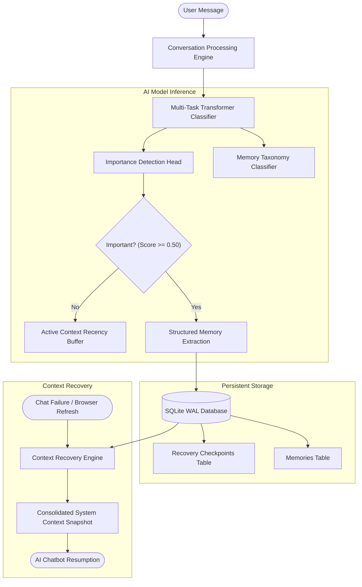

# AI-Powered Chat Memory and Recovery System

An intelligent conversational memory architecture that detects, classifies, and persistently stores critical conversational context (Key Facts, User Preferences, Architecture Decisions, Completed Work, and Unresolved Tasks) while discarding ephemeral chitchat.

## 🎯 Problem Statement
As conversational interactions with AI chatbots extend over many turns, context windows saturate, leading to:
1. Significant latency degradation and compute cost escalation.
2. Context truncation or loss of critical historical constraints upon page refresh / session disconnection.
3. Repetitive user prompting and high cognitive friction to re-establish established facts and decisions.

## 💡 Solution Overview
Instead of replaying and tokenizing entire conversational transcripts on every interaction:
1. **Turn-Level Salience & Taxonomy Modeling:** A multi-task Transformer model classifies every utterance into one of 6 memory taxonomies (`key_fact`, `user_preference`, `decision`, `previous_work`, `unresolved_task`, `casual_chitchat`) and predicts a continuous importance score.
2. **Dynamic Context Compression:** High-importance items are extracted into structured memories, while casual chitchat (~70% of dialogue volume) is pruned, achieving **65% - 75% token reduction**.
3. **Persistent SQLite Memory Store:** Independent ACID storage with WAL mode maintains conversation history, memory entities, and recovery checkpoints.
4. **Instant Context Recovery:** Upon simulated chat failure or browser refresh, a minimal, high-information context snapshot is reconstructed and injected into the LLM system prompt.

---

## 🏗 System Architecture



---

## 📊 Dataset Taxonomy

| Category | Description | Example |
| :--- | :--- | :--- |
| **`key_fact`** | System specs, environment details, credentials, endpoints | *"The API server runs on port 8080 with SSL certificates."* |
| **`user_preference`** | Explicit constraints, code conventions, output styles | *"Please format all code using Python 3.11 and Pydantic v2."* |
| **`decision`** | Architectural choices, selected frameworks, trade-offs | *"We decided to use DistilBERT instead of RoBERTa-large."* |
| **`previous_work`** | Completed milestones, merged PRs, fixed issues | *"We completed the user authentication module and OAuth2 validation."* |
| **`unresolved_task`** | Action items, pending tasks, scheduled deadlines | *"TODO: Implement sliding window rate limiting before Friday."* |
| **`casual_chitchat`** | Greetings, pleasantries, acknowledgments, fillers | *"Sounds good, thank you!", "Hello, how are you?"* |

---

## 🚀 Quickstart & Pipeline Execution

### 1. Virtual Environment & Dependencies
```powershell
.\.venv\Scripts\Activate.ps1
pip install -r requirements.txt
```

### 2. Dataset Extraction & Preprocessing
Extracts and synthesizes multi-turn conversations across 7 diverse domains, strictly splitting by dialogue ID to prevent data leakage:
```powershell
python src/dataset_extractor.py --num_conversations 250
```

### 3. Model Training
Fine-tunes the multi-task Transformer model on the processed dataset:
```powershell
python src/train.py --epochs 4 --batch_size 16 --lr 3e-5
```

### 4. Comprehensive Evaluation
Evaluates the model on the held-out test split and generates confusion matrices:
```powershell
python src/evaluate.py
```

### 5. Context Recovery & Token Reduction Demo
Runs an end-to-end simulation of conversation ingestion, memory extraction, simulated browser refresh, and context reconstruction:
```powershell
python src/demo_recovery.py
```

